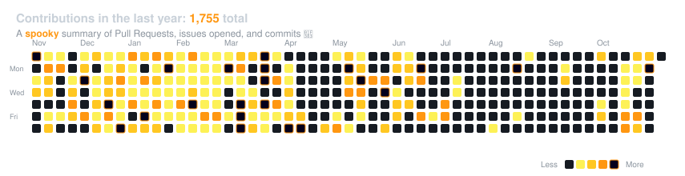

# Hi, I'm Om 👋

📍 **Surat ↔ India** | 🤖 **Agentic Systems Architect** | 🚀 **Founder @ AceIntelligence**

Building autonomous QA agents, document intelligence platforms, and high-frequency execution pipelines; obsessed with shipping at inference speed.

## Start Here

- 🐺 **[KHUNKHAAR](https://github.com/OMCHOKSI108/khunkhaar)** — Autonomous Senior QA & Security platform. Discovers hidden IDORs, SQLi, and multi-role RBAC leaks across real repos.
- ⚡ **[AceIntelligence](https://github.com/OMCHOKSI108/aceintelligence)** — Next-generation document intelligence platform that grounds multi-modal LLM queries with verifiable source references.
- ⚔️ **[elenchus](https://github.com/OMCHOKSI108/elenchus)** — An AI that disagrees with you three different ways to ruthlessly pressure-test arguments and decisions.
- 💥 **[gunfire](https://github.com/OMCHOKSI108/gunfire)** — Tactical mechanical keyboard audio engine. 12-gauge shotgun blasts per keystroke, pump reload on Enter.
- 🧬 **[hamminghell](https://github.com/OMCHOKSI108/hamminghell)** — Retrieval-augmented, provider-agnostic AI agent performing full-codebase-context code review.
- 📈 **[kotak-neo-algo](https://github.com/OMCHOKSI108/kotak-neo-algo)** — Production-grade algorithmic trading and quantitative research platform for Indian equity markets.
- 🛡️ **[TheKavach](https://github.com/OMCHOKSI108/TheKavach)** — Synthetic cybersecurity telemetry streaming platform with real-time AI security log analysis.
- 🚦 **[custos](https://github.com/OMCHOKSI108/custos)** — Intelligent LLM Gateway with dynamic semantic routing, caching, and token cost governance.

## Current Projects

### Agent Ecosystem & Autonomous Systems

- 🐺 **[khunkhaar](https://github.com/OMCHOKSI108/khunkhaar)** — Autonomous Senior QA & security engineering platform. Recon, AST analysis, dynamic port detection, and 18-category testing.
- ⚔️ **[elenchus](https://github.com/OMCHOKSI108/elenchus)** — Adversarial LLM agent engineered to dissect premises and stress-test assumptions.
- 🧬 **[hamminghell](https://github.com/OMCHOKSI108/hamminghell)** — Retrieval-augmented AI agent performing whole-repo AST code reviews.
- 🕸️ **[Multiagent-LangGraph-Research](https://github.com/OMCHOKSI108/Multiagent-LangGraph-Orchestrated-LLM-Research-Automation-Platform)** — Multi-agent LLM research automation platform orchestrating web search, synthesis, and report generation.
- 🧪 **[benchflow](https://github.com/OMCHOKSI108/benchflow)** — Meta-skill pipeline generating and refining domain-specific agent skills.
- 🔬 **[DataScientistAgent](https://github.com/OMCHOKSI108/DataScientistAgent)** — Autonomous AI agent executing Python code, RAG search, and data visualizations.
- 💡 **[VibeThinker-1.5B](https://github.com/OMCHOKSI108/VibeThinkerModel)** — Tiny model, big logic: Diversity-driven optimization eliciting deep reasoning in 1.5B parameters.

### Enterprise AI & Document Platforms

- ⚡ **[AceIntelligence](https://github.com/OMCHOKSI108/aceintelligence)** — Grounded document intelligence engine transforming enterprise PDFs into verifiable answers with citations.
- 📚 **[RAGStack](https://github.com/OMCHOKSI108/RAGStack)** — Production-grade RAG pipeline with GPU auto-detection, strict hallucination prevention, and SSE streaming.
- 💼 **[intelligencejobs](https://github.com/OMCHOKSI108/intelligencejobs)** — Hiring intelligence platform with automated resume parsing pipelines and E2E Playwright testing.
- 💬 **[NLP-DOCUMENT-CHATBOT](https://github.com/OMCHOKSI108/NLP-DOCUMENT-CHATBOT)** — Multi-format document reasoning chatbot built with Streamlit and Cohere.
- 🌾 **[gramsahay](https://github.com/OMCHOKSI108/gramsahay)** — Multilingual, voice-first digital assistant for rural and agricultural intelligence.

### Quant Finance & Market Engines

- 📈 **[kotak-neo-algo](https://github.com/OMCHOKSI108/kotak-neo-algo)** — Production-grade algorithmic trading system for Indian equities with real-time broker execution.
- 🤖 **[TradingAgents](https://github.com/OMCHOKSI108/TradingAgents)** — Multi-agent LLM financial trading framework coordinating technical, fundamental, and risk analysts.
- 📊 **[Venketesh](https://github.com/OMCHOKSI108/Venketesh)** — Scalable real-time and historical financial market data distribution platform.

### Cyber Defense & Tactical Hacks

- 💥 **[gunfire](https://github.com/OMCHOKSI108/gunfire)** — Tactical mechanical keyboard audio engine (12-gauge shotgun blasts per keypress).
- 🛡️ **[TheKavach](https://github.com/OMCHOKSI108/TheKavach)** — Synthetic cybersecurity telemetry streaming platform with live AI log analytics.
- 🚨 **[pralayAI](https://github.com/OMCHOKSI108/pralayAI)** — Incident response and MITRE ATT&CK intelligence agent.
- 🎥 **[VisionCCTV](https://github.com/OMCHOKSI108/VisionCCTV)** — Edge video intelligence combining YOLOv8, FaceNet, and CLIP for real-time facial recognition.
- 🔍 **[CodeSecurityAuditAgent](https://github.com/OMCHOKSI108/CodeSecurityAuditAgent)** — AI code review agent combining AST security rules with RAG vulnerability detection.

## GitHub Activity

## What I'm Doing

- **Living in the future** — Building autonomous QA and agentic engineering systems to make software testing self-healing.
- **Founder @ AceIntelligence** — Engineering enterprise document intelligence that eliminates hallucination with grounded citations.
- **Shipping at Inference Speed** — Multi-agent orchestration, custom MCP servers, and LLM telemetry.
- **Quant & Market Automation** — Low-latency algorithmic execution on Indian equity markets.

## Connect

---

## Philosophy

> "Ship beats perfect" — I build tools to solve my own bottlenecks, then let agents stress-test them in production.

### 🌶️ Unfiltered Hot Takes (Ragebaits)

> *"If you still manually test GraphQL and REST APIs with Postman in 2026, you're not an engineer — you're a human JSON parser."*

> *"90% of 'AI Startups' are just a 40-line prompt wrapped in Next.js and a Stripe subscription."*

> *"Vibe coding without autonomous regression tests is just gambling with syntax."*

> *"If your pull request takes 3 weeks to review, your engineering team is actually a slow email chain."*

> *"Clean Architecture is great until nobody ships. Ship to production, let real users break it, let agents audit it."*

Random Facts

- Powered by black coffee, Linux terminals, and mechanical keyboard clicks (`gunfire` enabled).
- Run 4+ Claude & OpenCode agent instances concurrently.
- Obsessed with finding zero-days, auth bypasses, and IDORs before malicious actors do.
- Red-teamed OpenAI's models on Kaggle.

